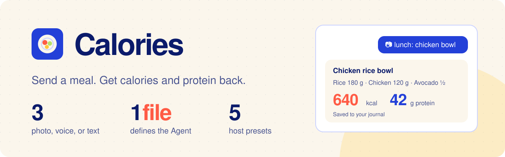

<h1>
  
</h1>

[](https://vitehub.dev)
[](https://github.com/vite-hub/calories/actions/workflows/check.yml)
[](./package.json)
[](./LICENSE)

A starter template for a [ViteHub](https://vitehub.dev) Agent. Send a meal to a Telegram bot as a photo, a voice note, or text. The Agent estimates calories and protein, saves the meal, and shows your day in a Nuxt dashboard. You can correct or delete entries and ask about your journal in the same chat.

[Live demo](https://calories.onmax.me) · [Start](#start) · [Customize](#customize) · [Deploy](#deploy) · [Export data](#export-data) · [ViteHub docs](https://vitehub.dev/docs/agents)

An independent project by [@onmax](https://github.com/onmax). It's a working example, not a framework, so replace anything you don't need.

> [!WARNING]
> Calorie, protein, and portion estimates can be wrong. This is an experiment, not medical or dietary advice.

## Start

You need Node.js 24.15+, pnpm 10, an [OpenRouter](https://openrouter.ai) key, and a Telegram bot token.

```sh
git clone https://github.com/vite-hub/calories.git
cd calories
pnpm install
cp .env.example .env   # add OPENROUTER_API_KEY, TELEGRAM_TOKEN, and your numeric TELEGRAM_ALLOWED_USER_ID
pnpm db:migrate
pnpm dev
```

Open <http://localhost:3000> for the landing page and <http://localhost:3000/dashboard> for the dashboard. The ViteHub Console, with recent Agent sessions, is at <http://127.0.0.1:3000/_vitehub>.

## Customize

| Change | File |
| --- | --- |
| Channel, models, Capabilities, and reply hooks | [`server/agents/calories/agent.ts`](./server/agents/calories/agent.ts) |
| How meals are estimated and checked | [`server/agents/calories/instructions.md`](./server/agents/calories/instructions.md) |
| Database schema | [`server/databases/config.ts`](./server/databases/config.ts) |
| Dashboard and its data | [`app/pages/dashboard.vue`](./app/pages/dashboard.vue), [`server/collections/meals.ts`](./server/collections/meals.ts) |
| Public photo previews | [`server/api/meals/[id]/photo.get.ts`](./server/api/meals/%5Bid%5D/photo.get.ts) |
| Landing page | [`public/index.html`](./public/index.html) |
| Host, storage, and Nuxt modules | [`nuxt.config.ts`](./nuxt.config.ts) |

The Agent saves a meal first and confirms it only after checking the items and totals in the database. Run history goes to the same database, so a failed history write never loses a meal. The dashboard shows photo previews resized to 768 pixels and stripped of camera metadata. Originals stay private.

## Deploy

The template ships with the Cloudflare preset (Workers, D1, and R2). ViteHub also has `vercel`, `netlify`, `deno`, and `node` presets. Switch in `nuxt.config.ts` and check the [host support matrix](https://vitehub.dev/docs/frameworks-hosts/support-matrix).

For Cloudflare, add your Cloudflare credentials, `TELEGRAM_WEBHOOK_SECRET`, and optionally `CLOUDFLARE_WORKER_DOMAIN` to `.env`. Without a domain, the Worker deploys to `workers.dev`. Then provision the stores, or set `CLOUDFLARE_D1_DATABASE_ID` to use an existing database:

```sh
pnpm provision:cloudflare
pnpm db:migrate:remote
pnpm run deploy
pnpm telegram:webhook --url https://your-app.example        # preview
pnpm telegram:webhook:apply --url https://your-app.example --confirm-origin https://your-app.example
```

## Export data

```sh
pnpm data:export            # D1 and the retained Telegram history, with attachments, to .backups/
pnpm data:export:database   # D1 only
```

The full export needs the production Telegram values and `VITEHUB_DEPLOYMENT_URL` in `.env`. Telegram keeps only a limited history window, so export before you need to recover. Then compare the archive with D1 and resend only the meals that are missing.

## Checks

```sh
pnpm run doctor && pnpm typecheck && pnpm test && pnpm build
```

CI runs the same checks. The template pins a Nuxt 5 nightly and ViteHub preview builds from `pkg.pr.new`, locked in `pnpm-lock.yaml`.

## License

[MIT](./LICENSE)
